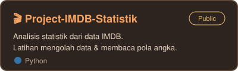
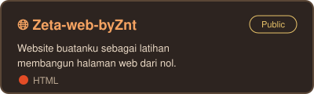
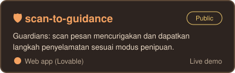

<!-- ☕ Cozy README untuk deryhafizh — taruh di repo deryhafizh/deryhafizh sebagai README.md, folder assets/ ikut diunggah -->

<div align="center">


<br/>


<br/>

[](https://dery-builds-a-future.lovable.app)

</div>

---

## 🛋️ Tentang Aku


Halo! Aku **Dery Hafizh Latief** (Znt), mahasiswa **Informatika Universitas Gunadarma angkatan 2025**. Aku tertarik pada programming, software development, dan teknologi baru. Masih belajar, tapi senang bereksperimen dan membangun proyek kecil supaya paham cara kerja teknologi.

```text
👋 Nama       : Dery Hafizh Latief (Znt)
🎓 Kampus     : Universitas Gunadarma, Informatika '25
🌱 Status     : Currently learning & building
🎯 Fokus      : Programming & software development
☕ Bahan bakar: Kopi, lagu santai, dan rasa penasaran
```

<br clear="right"/>

> *"Setiap baris kode adalah kesempatan untuk belajar sesuatu yang baru."* 🍃

---

## 🧰 Tech Stack yang Sedang Kupelajari

<div align="center">


</div>

<details>
<summary><b>🔍 Klik untuk lihat hal-hal yang kusukai di luar kode</b></summary>
<br/>

- 🧩 **Competitive Programming**: melatih logika, algoritma, dan problem solving
- 🛠️ **Software Development**: mengubah ide jadi produk digital yang berfungsi
- 📚 **Continuous Learning**: belajar lewat praktik dan eksperimen langsung
- 🤝 **Kolaborasi**: bertukar ide dan mengerjakan proyek bermakna bersama

</details>

<details>
<summary><b>🗺️ Klik untuk lihat rencana belajarku</b></summary>
<br/>

- [x] Dasar HTML & membuat halaman web
- [x] Dasar Python & analisis data sederhana
- [ ] CSS responsif & tampilan modern
- [ ] JavaScript untuk web interaktif
- [ ] Algoritma & competitive programming
- [ ] Bikin proyek kolaborasi pertama 🎉

</details>

---

## 🏡 Proyek di Rumahku

<div align="center">

<a href="https://project-imdb-statistik-o67m6svvssvp973uvaqwc6.streamlit.app/"></a>
<a href="https://deryhafizh.github.io/Zeta-web-byZnt/"></a>
<a href="https://scan-to-guidance.lovable.app"></a>

</div>

<details>
<summary><b>🎬 Project-IMDB-Statistik</b> <sub>(Python)</sub></summary>
<br/>

Proyek analisis statistik dari dataset IMDB. Isinya aplikasi `app.py`, data `IMBD.csv`, dan `requirements.txt` supaya mudah dijalankan ulang. Tempat aku latihan mengolah data dan membaca pola dari angka.

🔗 [Lihat repositori](https://github.com/deryhafizh/Project-IMDB-Statistik)

</details>

<details>
<summary><b>🌐 Zeta-web-byZnt</b> <sub>(HTML)</sub></summary>
<br/>

Website bertema Vestia Zeta (Hololive ID) yang kubuat dari nol dengan `index.html` dan `style.css`. Ada juga halaman media sosial dan mini game roll (`Game.html` + `game.py`) dengan hasil epic, langka, dan gagal.

🔗 [Lihat repositori](https://github.com/deryhafizh/Zeta-web-byZnt)

</details>

<details open>
<summary><b>🛡️ scan-to-guidance (Guardians)</b> <sub>(Web app)</sub></summary>
<br/>

**Guardians** membantu mengenali dan mengatasi pesan penipuan. Tempel pesan yang mencurigakan, tekan **Scan pesan**, lalu dapatkan langkah penyelamatan otomatis sesuai modus penipuannya. Alurnya sederhana: **Recognize · Learn · Act**, yaitu kenali, pelajari, lalu bertindak.

🔗 [Lihat repositori](https://github.com/deryhafizh/scan-to-guidance)

</details>

---

## 📊 Statistik GitHub

<div align="center">


<br/><br/>


</div>

---

## 🎵 Pojok Santai

<details>
<summary><b>☕ Klik kalau mau ditraktir kopi virtual</b></summary>
<br/>

```text
   ( (
    ) )
  ........
  |      |]
  \      /
   `----'

  Satu cangkir untukmu. Semangat belajarnya! 🌿
```

</details>

<div align="center">

> ✨ *Keep Learning. Keep Building.* ✨

</div>

---

## 💌 Mari Terhubung

Punya ide, peluang, atau proyek? Yuk ngobrol!

<div align="center">

[](mailto:derycikampek@gmail.com)
[](https://www.linkedin.com/in/dery-hafizh-372634449/)
[](https://dery-builds-a-future.lovable.app)

<br/>

<sub>Terima kasih sudah mampir, semoga harimu hangat seperti secangkir teh 🍵</sub>


</div>
